# Tutorial

The 🎓 tutorial in the game, step by step. Each scene answers things marked as unclear in the play-through logs
(`pnpm tutorial-coverage` lists which). Generated by `pnpm tutorial-doc`; do not edit by hand.

## suits

Tile identity: the three numbered suits, 1 to 9.

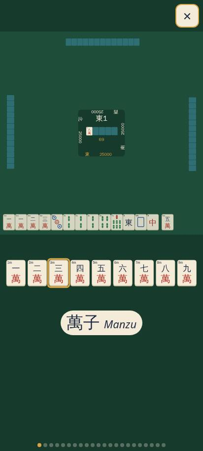
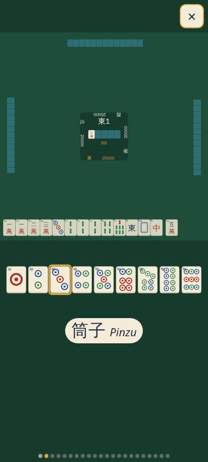
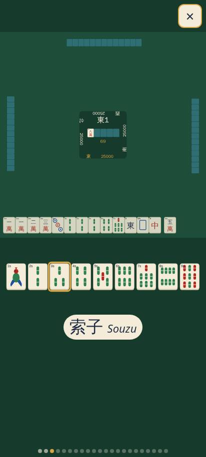
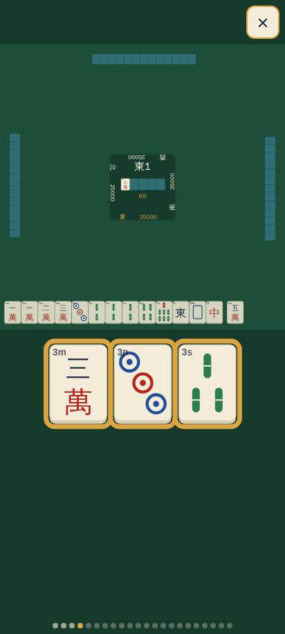

Glossary:

- **萬子** (Manzu): characters suit, 1-9 man
- **筒子** (Pinzu): dots suit, 1-9 pin
- **索子** (Souzu): bamboo suit, 1-9 sou

## honors

Honour tiles: winds and dragons; three of a dragon is yakuhai, 1 han.

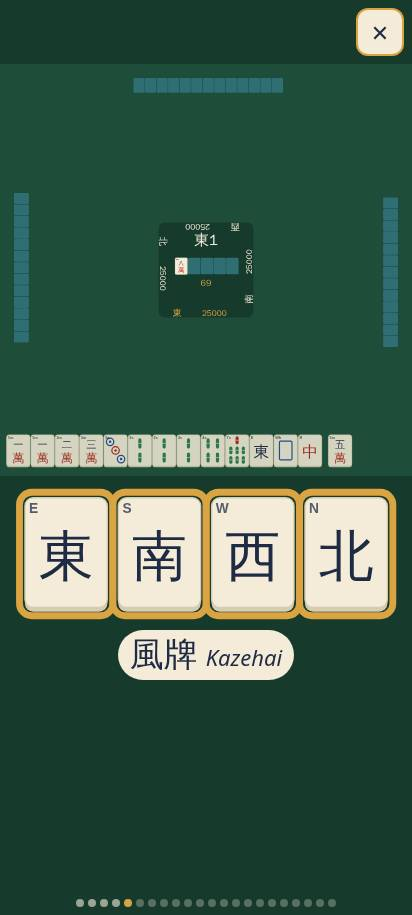
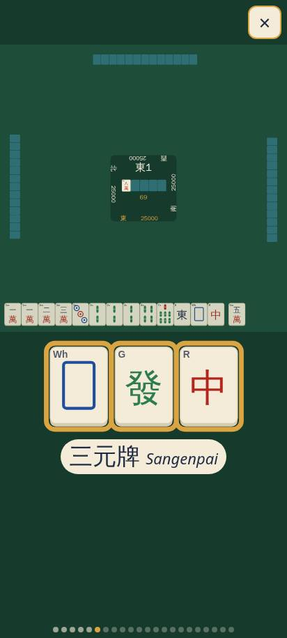
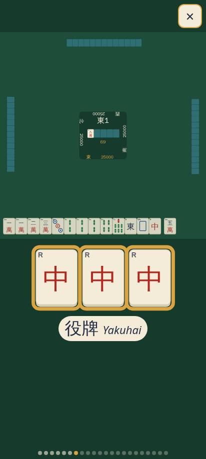
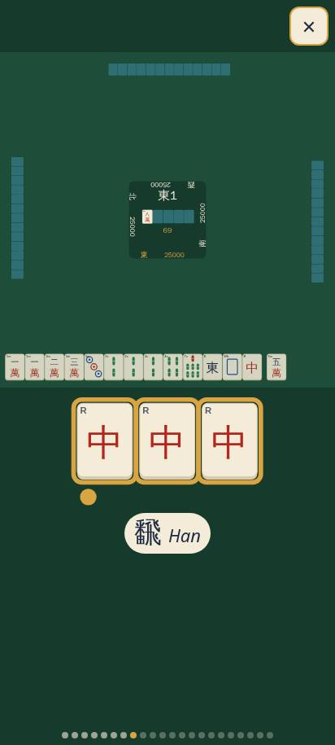
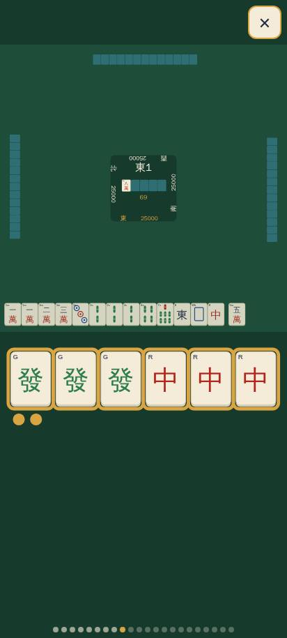

Glossary:

- **風牌** (Kazehai): wind tiles: East, South, West, North
- **三元牌** (Sangenpai): dragon tiles: white, green, red
- **役牌** (Yakuhai): value tiles; a triplet of a dragon (or your seat or round wind) is a yaku
- **飜** (Han): han, the unit of hand value; each yakuhai triplet is 1 han

## dora

Dora: the indicator shows the next tile in order, and each dora adds 1 han.

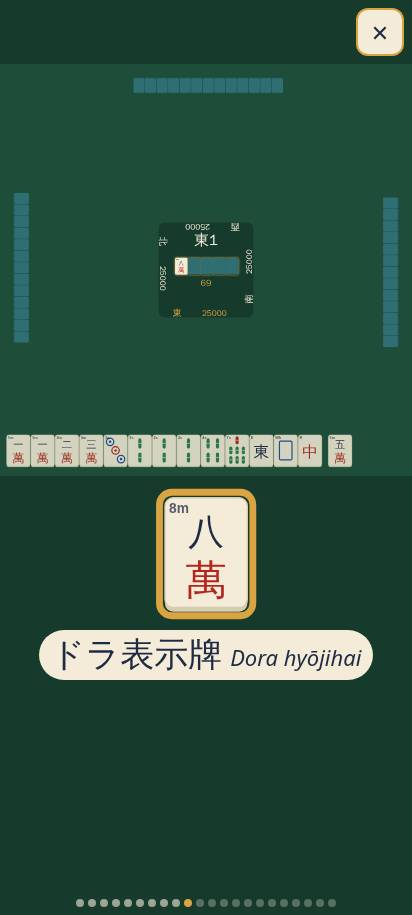
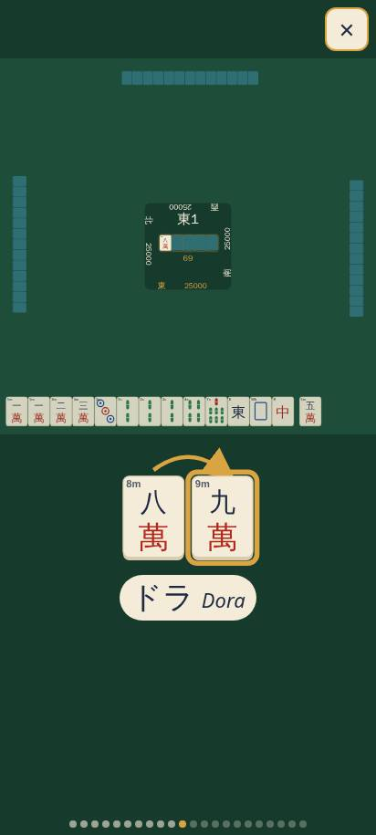

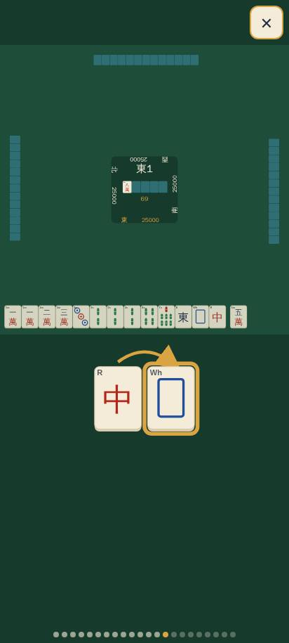
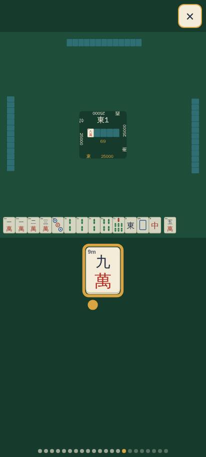

Glossary:

- **ドラ表示牌** (Dora hyōjihai): dora indicator, the face-up tile on the dead wall
- **ドラ** (Dora): dora, the tile after the indicator in order; each copy in a winning hand adds 1 han (not a yaku)

## seats

Seat winds, the dealer, the round marker and the 25000 starting points.

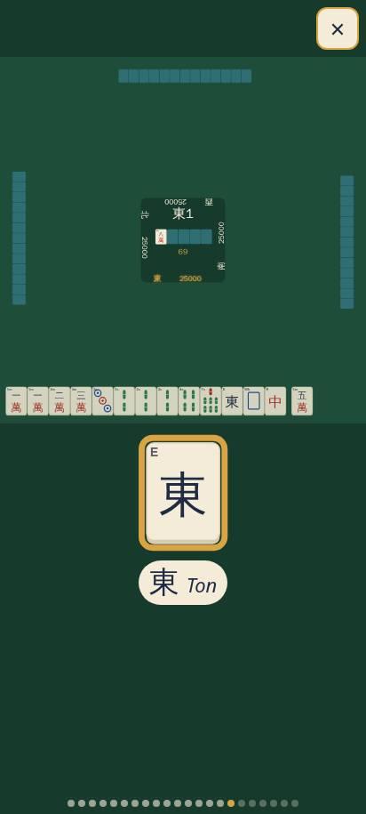
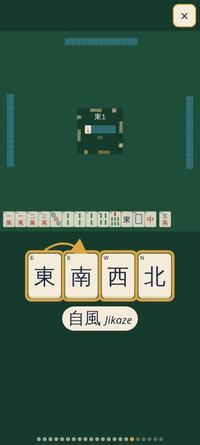
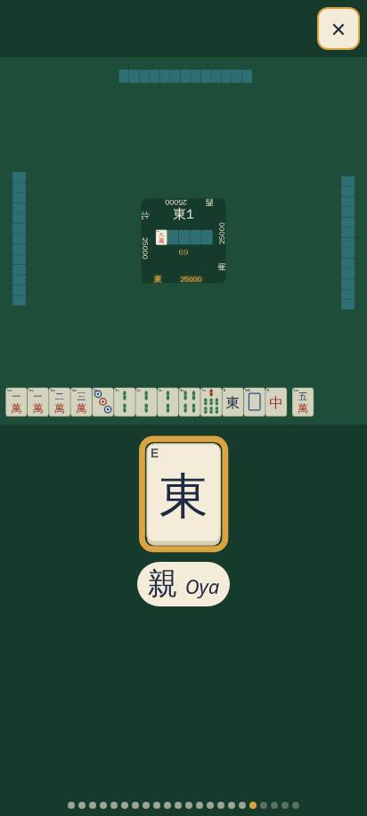
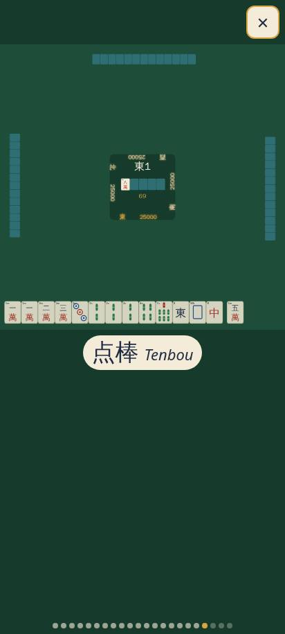
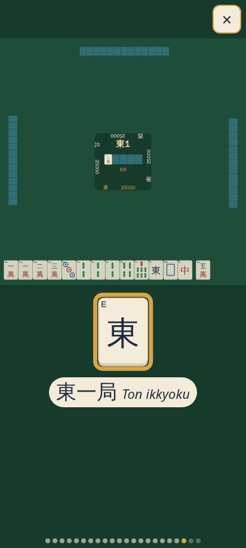

Glossary:

- **東** (Ton): East; the East seat is the dealer
- **自風** (Jikaze): seat wind; East, South, West, North go counter-clockwise from the dealer
- **親** (Oya): dealer; wins pay 1.5x and the dealer keeps the seat on a win or tenpai draw
- **点棒** (Tenbou): point sticks; everyone starts with 25000
- **東一局** (Ton ikkyoku): East round, hand 1 (the round marker in the centre)

## length

Match length: East-only (tonpuusen) or East plus South (hanchan).

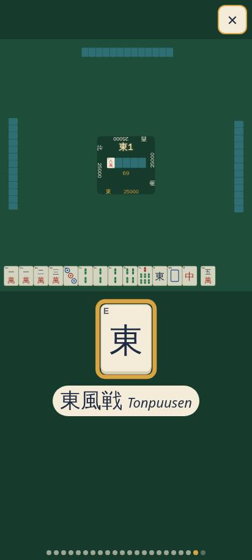
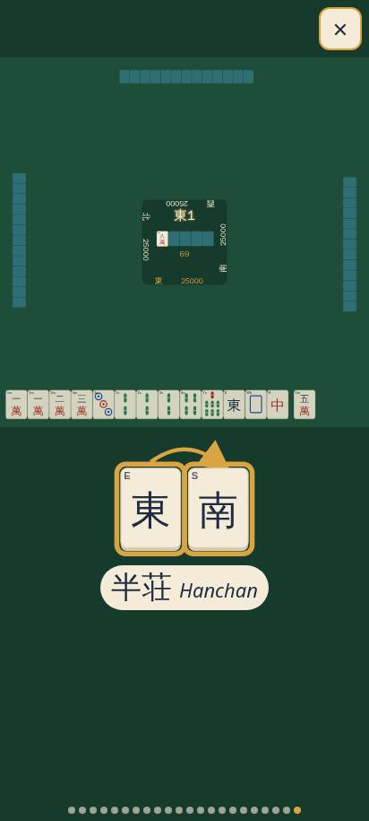

Glossary:

- **東風戦** (Tonpuusen): East-only match, four or more hands
- **半荘** (Hanchan): full match, East round then South round

